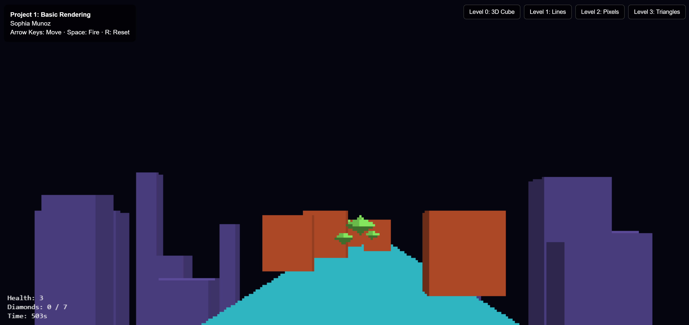

# CS5160 · Computer Graphics I


Coursework for **CS5160 Computer Graphics I** at the University of Cincinnati — building a
rendering pipeline from the ground up: pinhole projection, line and triangle rasterization,
depth buffering and shading on the 2D canvas, then moving to the GPU with WebGL2.

| | |
|---|---|
| **Instructor** | Dr. Jillian Aurisano |
| **Student** | Sophia Munoz · [munozsa@mail.uc.edu](mailto:munozsa@mail.uc.edu) |
| **About me** | Interested in computer graphics and web application development |
| **Last updated** | October 16, 2026 |

---

## Featured: Project 1 — Pinhole Camera, Rasterized Display



A first-person trench-run minigame: collect every diamond without running out of health.
The same game is rendered at three levels of fidelity, each written by hand:

| Level | Renderer |
|:-:|---|
| 1 | Wireframe with the canvas line API |
| 2 | 320×200 pixel grid with a DDA line-drawing algorithm |
| 3 | Filled triangles — edge functions, barycentric coordinates, `1/z` depth buffer, Lambertian shading, Sutherland–Hodgman near-plane clipping |

[📖 Full write-up](projects/project1) · [▶️ Watch the demo](https://youtu.be/mena3BZRrkg)

---

## Coursework

### Projects

| # | Project | Concepts | Status |
|:-:|---|---|:-:|
| 1 | [**Pinhole Camera, Rasterized Display**](projects/project1) | Perspective projection, rasterization, z-buffer, clipping, shading, collision detection | ✅ |
| 2 | [**Cube World**](projects/project2) | WebGL2, a landscape and skyscape built from cube models | 🚧 |

### Homeworks

| # | Homework | Concepts |
|:-:|---|---|
| 2 | [**First Rendering Algorithm**](homeworks/homework2) | Rendering a wireframe cube with a pinhole camera; keyboard camera movement |

### In-class activities

| # | Activity | Concepts |
|:-:|---|---|
| 1 | [**Practice Line Drawing**](activities/activity1) | Pixelated line rasterization, handling steep slopes and reversed endpoints |

---

## Running the code

Everything runs in the browser — no build step.

```bash
git clone https://github.com/munozsophia/computer-graphics-munozsa.git
cd computer-graphics-munozsa

# serve the repo locally, then open the page you want in the browser
python3 -m http.server 8000
```

| Open | Page |
|---|---|
| `http://localhost:8000/projects/project1/` | Project 1 Minigame |
| `http://localhost:8000/homeworks/homework2/first-algo-munozsa.html` | Homework 2 cube |
| `http://localhost:8000/activities/activity1/psuedopixel-line-drawing-munozsa.html` | Activity 1 lines |

---

## Repository structure

```text
computer-graphics-munozsa/
├── README.md
├── projects/
│   ├── project1/      # Pinhole Camera, Rasterized Display (canvas)
│   └── project2/      # Cube World (WebGL2)
├── homeworks/
│   └── homework2/     # First Rendering Algorithm
└── activities/
    └── activity1/     # Practice Line Drawing
```

Each folder has its own README covering goals, process, implementation and results.

---

<sub>Repository: [github.com/munozsophia/computer-graphics-munozsa](https://github.com/munozsophia/computer-graphics-munozsa)</sub>