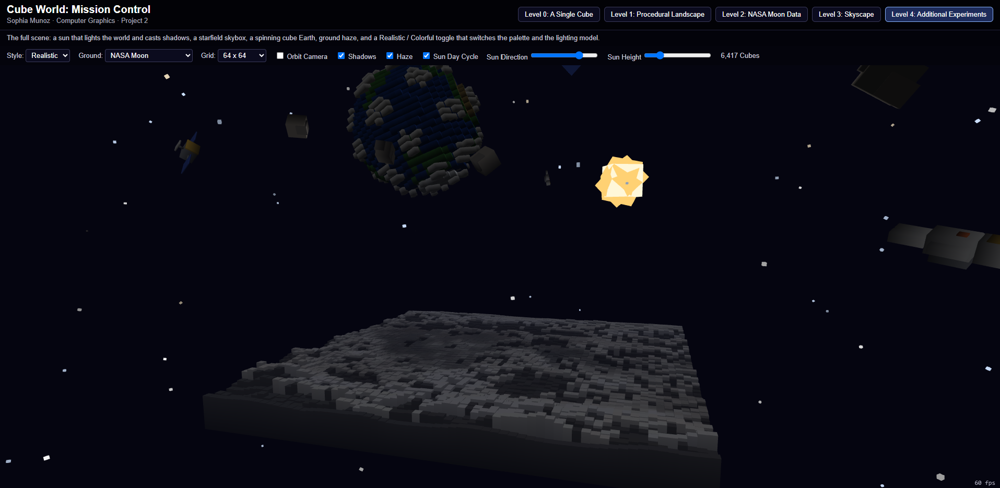
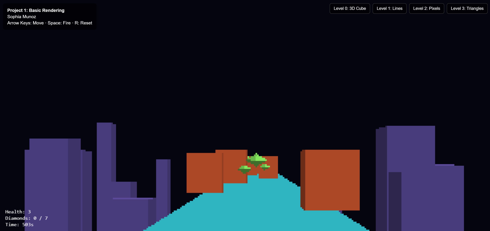

# CS5160 · Computer Graphics I


Coursework for **CS5160 Computer Graphics I** at the University of Cincinnati — building a
rendering pipeline from the ground up: pinhole projection, line and triangle rasterization,
depth buffering and shading on the 2D canvas, then moving to the GPU with WebGL2.

| | |
|---|---|
| **Instructor** | Dr. Jillian Aurisano |
| **Student** | Sophia Munoz · [munozsa@mail.uc.edu](mailto:munozsa@mail.uc.edu) |
| **About me** | Interested in computer graphics and web application development |
| **Last updated** | November 5, 2026 |

---

## Featured: Project 2 — Cube World: Mission Control



A WebGL2 landscape and skyscape built from **one model: a 2×2×2 cube**. A satellite-style camera orbits a lunar
surface sampled from real NASA elevation data, while cube astronauts, satellites and asteroids fly along Bezier
curves. Everything is drawn with a single instanced draw call.

| Level | What it adds |
|:-:|---|
| 0 | A single spinning cube and the page header |
| 1 | Procedural crater landscape: translation, y-scaling, vertex colors, orbiting look-at camera |
| 2 | Heights and colors sampled from NASA's CGI Moon Kit images, with a resolution selector |
| 3 | Sky objects built from cubes, moving on cubic Bezier curves with rotation, scaling and respawning |
| 4 | Sun lighting with heightfield shadows, starfield skybox, cube Earth, ground haze, and a realistic / colorful toggle |

[📖 Full Write-Up](projects/project2) · [▶️ Watch the Demo](https://youtu.be/XYNQev5NaLc)

---

## Featured: Project 1 — Pinhole Camera, Rasterized Display



A first-person trench-run minigame: collect every diamond without running out of health.
The same game is rendered at three levels of fidelity, each written by hand:

| Level | Renderer |
|:-:|---|
| 1 | Wireframe with the canvas line API |
| 2 | 320×200 pixel grid with a DDA line-drawing algorithm |
| 3 | Filled triangles — edge functions, barycentric coordinates, `1/z` depth buffer, Lambertian shading, Sutherland–Hodgman near-plane clipping |

[📖 Full Write-Up](projects/project1) · [▶️ Watch the Demo](https://youtu.be/mena3BZRrkg)

---

## Coursework

### Projects

| # | Project | Concepts | Status |
|:-:|---|---|:-:|
| 1 | [**Pinhole Camera, Rasterized Display**](projects/project1) | Perspective projection, rasterization, z-buffer, clipping, shading, collision detection | ✅ |
| 2 | [**Cube World: Mission Control**](projects/project2) | WebGL2, instanced rendering, matrices, procedural and image-sampled terrain, Bezier curves, Lambert and color shading, heightfield shadows, haze, skybox | ✅ |

### Homeworks

| # | Homework | Concepts |
|:-:|---|---|
| 2 | [**First Rendering Algorithm**](homeworks/homework2) | Rendering a wireframe cube with a pinhole camera; keyboard camera movement |

### In-class activities

| # | Activity | Concepts |
|:-:|---|---|
| 1 | [**Practice Line Drawing**](activities/activity1) | Pixelated line rasterization, handling steep slopes and reversed endpoints |
| 2 | [**WebGL Cubes**](activities/activity2/webgl-cubes-v3) | WebGL cubes starter activity |
| 3 | [**Camera Move**](activities/activity3/camera-move) | Moving the camera in WebGL |

---

## Running the code

Everything runs in the browser — no build step.

```bash
git clone https://github.com/munozsophia/computer-graphics-munozsa.git
cd computer-graphics-munozsa

# serve the repo locally, then open the page you want in the browser
python3 -m http.server 8000
```

| Open | Page |
|---|---|
| `http://localhost:8000/projects/project1/` | Project 1 Minigame |
| `http://localhost:8000/projects/project2/` | Project 2 Cube World |
| `http://localhost:8000/homeworks/homework2/first-algo-munozsa.html` | Homework 2 Cube |
| `http://localhost:8000/activities/activity1/psuedopixel-line-drawing-munozsa.html` | Activity 1 Lines |

The WebGL activities and Project 2 load shaders and image files, so they need to be opened
through the local server above (not by double-clicking the HTML file). Each WebGL folder may
also include its own `package.json`; check that folder's README if it has one.

---

## Repository structure

```text
computer-graphics-munozsa/
├── README.md
├── projects/
│   ├── project1/      # Pinhole Camera, Rasterized Display (canvas)
│   └── project2/      # Cube World: Mission Control (WebGL2)
├── homeworks/
│   └── homework2/     # First Rendering Algorithm
└── activities/
    ├── activity1/     # Practice Line Drawing
    ├── activity2/     # WebGL Cubes (webgl-cubes-v3)
    └── activity3/     # Camera Move (camera-move)
```

Each folder has its own README covering goals, process, implementation and results.

---

<sub>Repository: [github.com/munozsophia/computer-graphics-munozsa](https://github.com/munozsophia/computer-graphics-munozsa)</sub>