# Project 2 - Cube World: Mission Control

## The Project's Overview

### **Goals**

The goal for this project was to build a landscape and a skyscape in **WebGL2** (no Three.js or other frameworks) using **only one model: a 2x2x2 cube**. Every mountain, crater, satellite, astronaut, star and planet in the scene is that same cube, moved, stretched, rotated and colored by a model matrix. The project is built up over five levels, where each level adds one new idea on top of the last.

**Run it locally:** Level 2 and up load image files, and a browser blocks reading pixels from images opened with `file://` (the canvas becomes "tainted"). Serve the project folder first, then open the page:

```bash
cd projects/project2
python -m http.server 8000
# open http://localhost:8000/
```

**Live version:** *(add the deployed link here)*

### **Process**

**Design**

My design is a space / NASA space theme. The viewer is a satellite flying over a cratered lunar surface made from real NASA elevation data. Overhead, cube-built satellites, astronauts and asteroids drift along Bezier curves, with a rotating cube Earth, a sun and a starfield in the background. A style toggle switches the whole scene between a **realistic** NASA look and a bright **colorful** look.

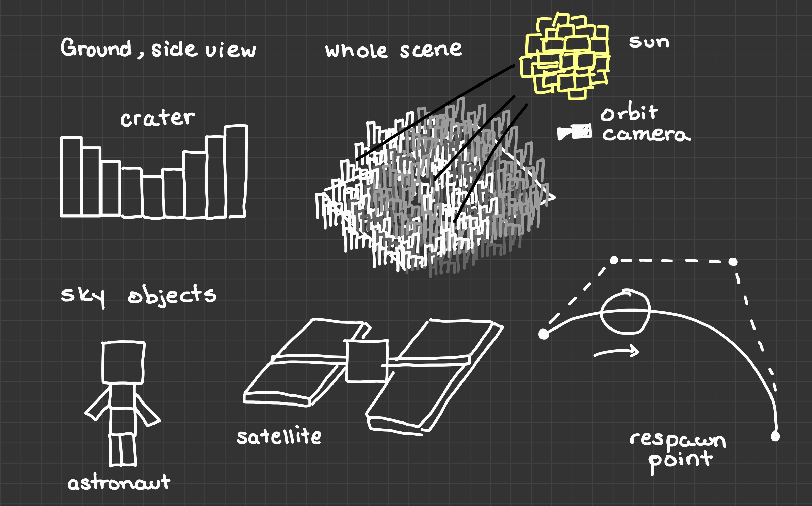

**Object Types**

All of the objects are the same cube mesh. Only the matrix and tint are different.

| Object | How it is built from cubes |
|---|---|
| **Ground column** | One cube per grid cell, scaled in `y` to the height of that cell, tinted by height (Level 1) or by the NASA color image (Level 2). |
| **Satellite** | 8 cubes: body, gold foil band, two arms, two blue solar panels, antenna mast, dish. |
| **Astronaut** | 9 cubes: torso, helmet, gold visor, life-support pack, mission patch, two arms, two legs. |
| **Asteroid** | 3 cubes of different sizes and gray-brown tints, clumped together. |
| **Sun** | 3 glowing cubes at different angles, which make a spiky star shape. |
| **Earth** | A sphere of about 1,250 cubes colored by latitude and longitude (ocean, land, desert, polar ice), plus a sparse shell of about 300 white cubes for clouds. |
| **Stars** | 700 tiny glowing cubes on a very large sphere around the camera. |

**Experience**

The page opens on Level 0, a single spinning cube. The level buttons in the header switch between levels. Each level has its own controls under the header:

| Level | Controls |
|---|---|
| 0 | none |
| 1 | grid size (32 - 256), orbit camera on/off, cube count |
| 2 | resolution (16 - 512), orbit camera on/off, cube count |
| 3 | ground (NASA Moon / procedural), grid size, orbit camera, show Bezier paths |
| 4 | style (realistic / colorful), ground, grid size, orbit camera, shadows, haze, sun day cycle, sun direction and height sliders |

A frames-per-second counter in the corner shows what each setting costs.

---

#### **Implementation**

**File Structure**

| File | Responsibility |
|---|---|
| **`index.html`** | Page structure, header, level buttons, canvas, script load order |
| **`style.css`** | Visual styling for the header, level controls and canvas |
| **`math.js`** | 4x4 matrix math: multiply, translation, scaling, rotations, perspective, lookAt |
| **`shaders.js`** | The vertex and fragment shaders (GLSL source as strings) |
| **`gl-utils.js`** | Compiles and links shaders into a program |
| **`cube.js`** | The one cube model (24 vertices, normals, indices), vertex-color procedures, GPU buffers and the instancing setup |
| **`renderer.js`** | Owns the WebGL context, builds and uploads the instance list, and draws all cubes with one call |
| **`camera.js`** | Camera state (eye, target, up, field of view) and the view-projection matrix |
| **`level0.js`** | Level 0: one cube and the header |
| **`level1.js`** | Level 1: procedural crater landscape and orbiting camera |
| **`level2.js`** | Level 2: landscape sampled from the NASA images, resolution selector |
| **`level3.js`** | Level 3: Bezier-driven sky objects |
| **`level4.js`** | Level 4: sun, shadows, skybox, Earth, haze, realistic / colorful toggle |
| **`main.js`** | Level list, level buttons, animation loop, fps counter |
| **`images/`** | `moon-height.png` and `moon-color.png`, cropped from NASA's CGI Moon Kit to both be 512x512 |

The scripts are plain `<script defer>` tags that share one global scope, so their order in `index.html` matters: `math`, `shaders`, `gl-utils`, `cube`, `renderer`, `camera`, `level0` to `level4`, then `main`. Each level is an object with `setup()` (runs once when the level is selected), `update(t)` (runs every frame) and optional `leave()` and `buildOptions()` functions.

**Level 0:** *Project Preliminaries*

Contains a single 2x2x2 cube. The cube spins around the `y` axis by building a new rotation matrix every frame, so it reads as a 3D object and not a flat hexagon. The cube is colored by its corner positions (corner `(-1,-1,-1)` is black, `(1,1,1)` is white), which makes it easy to see the GPU blending the vertex colors across each face.

**Level 1:** *Procedural Landscape*

I wanted to make the landscape look like a crater. These are the steps I took to make that possible:

- **1a, translation:** a grid of `n x n` cubes laid out on the `x-z` plane.
- **1b, scaling:** each cube is stretched in `y` by a height procedure. The ground is two sine waves plus 9 seeded craters (a bowl pushed down inside the radius and a raised rim around the edge).
- **1c, vertex colors:** every cube has dark vertices at its base and light vertices at its top, so each column fades from dark to light. A per-cube tint based on height colors it from gray-blue lowlands to pale tan highs.
- **1d, camera:** an orbiting camera whose eye moves around a circle while the target stays fixed, so it always looks at the center.
- A grid menu offers 32, 64, 128 and 256 cubes per side, for up to 65,536 cubes.

**Level 2:** *NASA Moon Data*

I replaced the height procedure by two real NASA images: a grayscale elevation map (white is high, black is low) and the matching LROC color photo. I added a that resolution selector goes from 16x16 (256 cubes) up to 512x512 (one cube per image pixel, 262,144 cubes) so the effect of sampling resolution is easy to see. Each cube samples an area of the image, and the color photo becomes the cube's tint.

**Level 3:** *Skyscape*

I have 13 sky objects (2 satellites, 2 astronauts, 9 asteroids) fly over the landscape, with each one following its own **cubic Bezier curve**. While it travels each object also rotates and pulses in size (scale). When an object completes its curve path, or drifts too far from the landscape, it respawns on a brand new random curve. I added a "Show Bezier Paths" checkbox that draws each curve as a trail of small cubes with its four control points as larger colored cubes.

**Level 4:** *Mission Control*

The full scene. A **sun** lights the world and casts **shadows** from the crater walls. A **starfield skybox** and a **rotating cube Earth** fill the background, and **haze** hangs over the ground. A **realistic / colorful toggle** switches the palette and the lighting model. The sun can run a day cycle or be moved with sliders.

---

**Applied Computer Graphics Concepts**

Each concept below is paired with the code that implements it.

*The Cube Model*

The only model in the project is a cube centered at the origin whose corner coordinates are all `-1` or `+1`, so it is 2 x 2 x 2. The cube has 8 corners but the mesh stores **24 vertices** (4 per face), because the corners of two faces sit at the same position but need different normals. The lighting also depends on the normal, so a corner shared by a top face and a side face has to be stored once for each. Each face lists its corners counter-clockwise **as seen from outside the cube**:

```javascript
const CUBE_FACES = [
  { normal: [ 0,  0,  1], corners: [4, 5, 6, 7] }, // front  (+z)
  { normal: [ 0,  0, -1], corners: [1, 0, 3, 2] }, // back   (-z)
  { normal: [ 1,  0,  0], corners: [5, 1, 2, 6] }, // right  (+x)
  { normal: [-1,  0,  0], corners: [0, 4, 7, 3] }, // left   (-x)
  { normal: [ 0,  1,  0], corners: [7, 6, 2, 3] }, // top    (+y)
  { normal: [ 0, -1,  0], corners: [0, 1, 5, 4] }  // bottom (-y)
];
```

The winding order is what makes the **back-face culling** work: `gl.enable(gl.CULL_FACE)` has the GPU to skip any triangle whose vertices appear clockwise on screen, which are the faces pointing away from the camera. In WebGL the GPU is able to do it for every triangle.

*Modeling Transforms with Matrices*

Using WebGL a single 4x4 **model matrix** per cube holds its translation, rotation and scale. Matrices are stored **column-major** in a `Float32Array(16)` so element `(row, col)` is at index `col * 4 + row`. My multiply function computes `a x b`:

```javascript
multiply(a, b) {
    const result = new Float32Array(16);
    for (let col = 0; col < 4; col++) {
        for (let row = 0; row < 4; row++) {
            let sum = 0;
            for (let k = 0; k < 4; k++) {
                sum += a[k * 4 + row] * b[col * 4 + k];
            }
            result[col * 4 + row] = sum;
        }
    }
    return result;
}
```

The **order matters.** A matrix applied to a point reads right to left, so `translation x scaling` means "scale first, then move". I have every landscape column use that order. The cube is 2 units tall, so a scale of `h / 2` makes it `h` tall, and moving it by `h / 2` puts its bottom at `y = 0`:

```javascript
const model = mat4.multiply(
    mat4.translation(x, h / 2, z), // 2) move to the grid position
    mat4.scaling(cell / 2, h / 2, cell / 2) // 1) stretch into a column
);
```

This was actually a bug I had during development. My first `multiply` computed `b x a`, so objects were scaled after being moved and ended up in the wrong place. So swapping the indices to `a[k * 4 + row] * b[col * 4 + k]` fixed it.

*Instanced Rendering*

A 256 x 256 landscape is 65,536 cubes. When I used a draw call per cube it would render far too slow, so every cube in a level is drawn with **one call** to `drawElementsInstanced`. The mesh buffers (positions, colors, normals) are uploaded once. A second buffer holds one entry **per cube**: a 4x4 model matrix and an RGB tint. I also have `vertexAttribDivisor(location, 1)` advance through that buffer once per instance and not once per vertex. A `mat4` attribute takes four attribute slots (locations 3 to 6), one per column:

```javascript
for (let column = 0; column < 4; column++) {
    const location = 3 + column; // aModel uses locations 3, 4, 5, 6
    gl.enableVertexAttribArray(location);
    gl.vertexAttribPointer(location, 4, gl.FLOAT, false, stride, column * 16);
    gl.vertexAttribDivisor(location, 1);
}
gl.vertexAttribDivisor(7, 1); // aTint, one per instance
```

```javascript
gl.drawElementsInstanced(gl.TRIANGLES, cubeMesh.indexCount, gl.UNSIGNED_SHORT, 0, instanceCount);
```

Each level's job is only to fill a `Float32Array` of instances with `setInstance(list, index, modelMatrix, r, g, b)` and call `uploadInstances(list)`. The renderer does the rest. Before every draw the renderer sets the program, uniforms and VAO, so nothing depends on what a previous draw left bound.

*The Camera: View and Projection*

The vertex shader multiplies each vertex by `uViewProjection * aModel`. The **view** matrix places the camera and the **projection** matrix applies perspective. My `lookAt` builds three perpendicular camera axes from the eye, the target and an up vector, then moves the whole world so the camera sits at the origin looking down `-z`:

```javascript
const zAxis = normalize(subtract(eye, target)); // from the target back to the camera
const xAxis = normalize(cross(up, zAxis)); // the camera's right
const yAxis = cross(zAxis, xAxis); // the camera's true up
```

`perspective(fieldOfView, aspect, near, far)` is basically the WebGL version of the `u = x / z` divide in Project 1. Its key line copies `-z` into `w`, and the GPU then divides every coordinate by `w` automatically:

```javascript
m[11] = -1; // copies -z into w, so the GPU divides by depth
```

The orbit camera moves the **eye** around a circle while the **target** stays at the center, so it always faces the landscape:

```javascript
camera.eye = [
    camera.target[0] + RADIUS * Math.cos(angle),
    HEIGHT,
    camera.target[2] + RADIUS * Math.sin(angle)
];
```

The camera playground helped me see what each parameter does. The field of view changes how much of the scene fits in the frame (smaller zooms in, larger shows more and exaggerates perspective). The aspect ratio has to match the canvas or the image stretches. Near and far set which depths are drawn at all.

*Vertex Colors and Interpolation*

I only decided the colors at the cube's 24 vertices and the **fragment shader receives a blend** of them. The GPU interpolates each pixel's color between the three vertices of its triangle using barycentric weights, the same weights I computed by hand in Project 1's `drawTriangle`. The `terrain` color set uses that to fade every column from dark at its base to bright at its top:

```javascript
terrain: (x, y, z) => {
    const shade = 0.3 + 0.7 * ((y + 1) / 2);
    return [shade, shade, shade];
}
```

Since every ground cube is stretched into a column, this one rule shades the whole landscape. The vertex shader then multiplies by the per-cube tint (`vColor = aColor * aTint`), so the vertex colors give the shading and the tint gives the cube its color, which is how one 24-vertex mesh can be gray, blue, gold or green.

*Procedural Heights (Level 1)*

The Level 1 height function takes a world position and returns a height, so it is a sample of a procedure, with no image involved. The rolling ground comes from two sine waves, and each crater is a smooth bowl inside its radius plus a bump near its edge that makes the rim:

```javascript
const d = Math.hypot(x - c.x, z - c.z) / c.radius; // 0 at the center, 1 at the rim
if (d < 1) {
    h -= c.depth * (1 - d * d); // smooth bowl
}
const rimOffset = (d - 1.05) * 3;
h += c.rim * Math.exp(-rimOffset * rimOffset); // raised rim
```

The craters come from a seeded random number generator (mulberry32), so they are in the same place on every page load.

*Sampling Images (Level 2)*

Since the browser doesn't hand over an image's pixels directly. I had the the image drawn onto a hidden 2D canvas and called `getImageData`:

```javascript
const hidden = document.createElement("canvas");
hidden.width = image.width;
hidden.height = image.height;
const context = hidden.getContext("2d", { willReadFrequently: true });
context.drawImage(image, 0, 0);
return context.getImageData(0, 0, image.width, image.height); // RGBA bytes
```

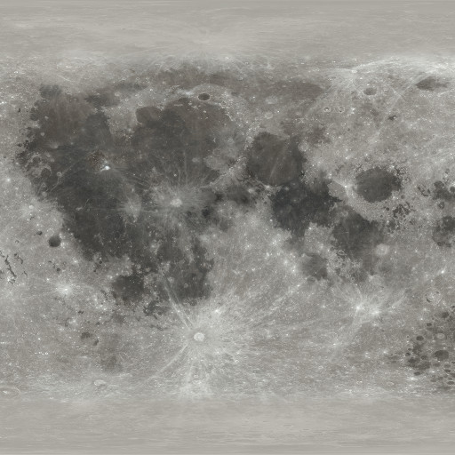
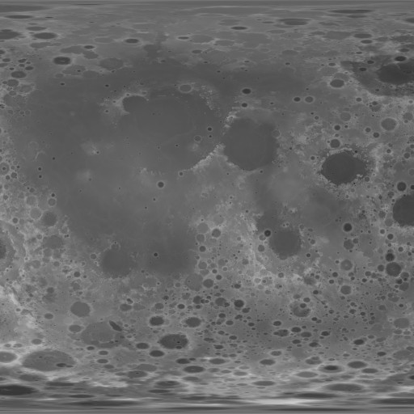

Both images are the same region of the Moon at the same size, so one position indexes both. The resolution selector changes how many cubes cover the image. With `n x n` cubes over a `512 x 512` image, each cube covers a block of `512 / n` pixels, and I **average** the block, not pick one pixel:

```javascript
const x0 = Math.floor(col * data.width / n);
const x1 = Math.max(x0 + 1, Math.floor((col + 1) * data.width / n));
// ... loop over the block, summing height and color, then divide by count
return { height: h / count, r: r / count, g: g / count, b: b / count };
```

The averaging made it a box filter that makes a low-resolution grid look like a smoothed copy of the image, whereas picking a single pixel would alias and flicker. At 512 x 512 each block is exactly one pixel, so that is the full detail of the image. The height becomes the column height (`BASE_HEIGHT + height * HEIGHT_SCALE`) and the color photo becomes the tint.

*Bezier Curves (Level 3)*

A **cubic Bezier curve** is defined by four control points, `P0`, `P1`, `P2` and `P3`. The curve starts at `P0` and ends at `P3`, and `P1` and `P2` only *pull* it, so it does not pass through them. For `t` from 0 to 1:

```
B(t) = (1-t)^3 P0  +  3(1-t)^2 t P1  +  3(1-t) t^2 P2  +  t^3 P3
```

The four weights are the Bernstein polynomials and they are never negative and always add up to 1, so `B(t)` is a weighted average of the control points and the curve stays inside their convex hull. At `t = 0` the weight on `P0` is 1, so the curve starts there. At `t = 1` the weight on `P3` is 1, so it ends there. I built the curves with **De Casteljau's algorithm**, which linearly interpolates between the control points three times. My code applies the formula directly:

```javascript
function cubicBezier(p0, p1, p2, p3, t) {
    const u = 1 - t;
    const w0 = u * u * u;
    const w1 = 3 * u * u * t;
    const w2 = 3 * u * t * t;
    const w3 = t * t * t;

    return [
        w0 * p0[0] + w1 * p1[0] + w2 * p2[0] + w3 * p3[0],
        w0 * p0[1] + w1 * p1[1] + w2 * p2[1] + w3 * p3[1],
        w0 * p0[2] + w1 * p1[2] + w2 * p2[2] + w3 * p3[2]
    ];
}
```

Each frame an object's `t` advances by `dt / duration`, and `cubicBezier` gives its new 3D position. To make a curve, `newCurve()` picks a start far out on one side and an end roughly on the opposite side, plus two control points closer in and higher up that bend the path over the landscape. When `t` reaches 1, or the object is more than 115 units away, `newCurve()` runs again and the object respawns on a new path. It fades in and out with a `smoothstep` over the first and last points of the curve so respawning never looks like a pop.

I also have the objects **rotate** and **scale** while it moves along the curve. Every cube of an object is placed with five matrices multiplied together, read right to left:

```
model = T(position) x R(tumble) x S(object size) x T(part offset) x S(part size)
```

Here `S(part size)` shapes one cube into a panel, a limb or a helmet. `T(part offset)` moves it to its place inside the object. `S(object size)` scales the whole object, and it pulses with `1 + 0.12 * sin(time)`. `R(tumble)` spins the whole object. `T(position)` is the point on the Bezier curve. This is how an astronaut made of 9 stretched cubes moves as a single body.

*Lighting: Lambertian Diffuse*

The brightness of a face is the dot product of its **normal** and the direction toward the light, clamped at zero, plus an ambient floor so faces turned away from the light are not pure black:

```glsl
float diffuse = max(dot(normalize(vNormal), normalize(uLightDir)), 0.0);
float light = uAmbient + (1.0 - uAmbient) * diffuse;
vec3 color = mix(vColor, vColor * light, uUseLighting);
```

The vertex shader turns each normal with the cube's model matrix: `vNormal = normalize(mat3(aModel) * aNormal)`. Only the rotation part matters here, and since the cube's normals point along axes, stretching a column does not change which way its sides face. Level 0 turns lighting off (`uUseLighting = 0`) so the raw vertex-color blending is visible.

*Depth Testing*

In WebGL I used, `gl.enable(gl.DEPTH_TEST)`, plus clearing the depth buffer each frame (`gl.clear(gl.COLOR_BUFFER_BIT | gl.DEPTH_BUFFER_BIT)`). The GPU keeps the nearest depth per pixel and discards fragments that are farther away.

*Shadows (Level 4)*

The ground is a heightfield, so shadows can be found by moving toward the sun. For each column, I move across the grid in the direction of the sun. At each step I compare the height of the column I land on with the height of the sight line to the sun at that point. If the column is taller, the sun is blocked and this column is in shadow:

```javascript
for (let k = 1; k <= maxSteps; k++) {
    const px = x + dx * stride * k;
    const pz = z + dz * stride * k;
    // ... find the column under (px, pz)
    if (level4Heights[r * n + c] > h0 + slope * stride * k + 0.02) {
        level4Shadow[i] = 0.35; // blocked: darken this column
        break;
    }
}
```

`slope` is how fast the sight line climbs per unit of horizontal travel (`sunHeight / horizontalDistance`), so a low sun gives long shadows and a high sun gives short ones. It is cheap because it is a loop over the grid.

*Color Shading*

The colorful style changes how light turns into brightness. Instead of the smooth `0..1` diffuse value, the fragment shader snaps it into a few flat bands:

```glsl
if (uColorSteps > 0.5) {
    diffuse = ceil(diffuse * uColorSteps) / uColorSteps;
}
```

With `uColorSteps = 3`, the brightness can only be 0, 1/3, 2/3 or 1, which gives the flat cell-shaded look. The color palette also replaces the ground's photo colors with a banded five-stop candy gradient chosen from each column's height, uses a purple sky and colorful stars, and recolors the satellites and asteroids. Everything else (cubes, matrices, camera) is the same.

*Atmosphere: Ground Haze*

The fragment shader blends each pixel toward a fog color based on how far it is from the camera and how high it is. The vertex shader passes the camera distance (`vDepth = gl_Position.w`, which is the depth after the projection step) and the world height (`vWorldY`) to the fragment shader:

```glsl
float haze = uFogAmount * (1.0 - exp(-vDepth * 0.012)) * exp(-max(vWorldY, 0.0) * 0.06);
color = mix(color, uFogColor, haze);
```

The first factor makes haze thicker with distance. The second makes it thin out quickly with height, so the haze is closer to the ground, which makes the far side of the landscape fade and gives the scene depth while the sky and stars stay crisp.

*Skybox, Glowing Cubes and the Sun*

For the skybox, I needed it to move with the camera. The stars are placed on a sphere of radius 280 around the origin, and every frame they are multiplied by a matrix that translates them to the camera's position, so the camera can never approach them. They are drawn in the same instanced call as everything else.

A cube **glows** when its tint has a negative red value. The vertex shader reads that flag and passes it on, and the fragment shader skips lighting and haze:

```glsl
float glow = aTint.r < 0.0 ? 1.0 : 0.0;
vec3 tint = abs(aTint);
...
color = mix(color, vColor, vGlow); // glowing cubes ignore lighting and haze
```

The sun's position is its direction from the center, built from an azimuth and an elevation. That same direction is also the light direction (`renderSettings.lightDir`), so the visible sun and the light always agree.

*The Earth Made of Cubes*

The Earth is a sphere of cubes, built by testing every position `(i, j, k)` in a 3D grid and keeping those whose distance from the center is within half a cube of the radius. Each cube's position is converted to a latitude and longitude, `lat = asin(j / r)` and `lon = atan2(k, i)`, and a few overlapping sine waves of `lat` and `lon` decide land or ocean. Polar ice is `abs(lat) > 1.15`.

A second, sparser shell just outside the surface makes the clouds. The whole Earth is tilted (`rotationZ`) and spun (`rotationY`), and the clouds spin slightly faster. Since the Earth is lit by the same sun, I get a day side and a night side.

---

**Challenges**

- **Reading the NASA images.** The first attempt to read the image pixels failed with a "tainted canvas" error. I learned from the class Discord that a page opened from `file://` can't read pixels from images, and that serving the folder (`python -m http.server`) fixes it.
- **Matrix order.** The `multiply` bug described above.
- **Performance.** Every cube's matrix is built on the CPU, which limits how large the grid can get. The GPU draws the cubes fast, but building and uploading 65,536 matrices is memory- and CPU-bound. Level 4 recomputes shadows when the sun moves, so the large grids are the slowest. The added the fps counter and resolution menus for this reason.

**Future Work**

| Future Additions | | |
|---|---|---|
| **Performance** | Move the heights and per-cube offsets into the vertex shader, sampling the images as textures | Compute shadows on the GPU with a shadow map |
| **Scene** | Create a globe of the Moon using NASA images | Let the camera be flown with the keyboard |
| **Look** | Add specular highlights for shiny surfaces such as solar panels | Add terraced heights in the colorful style |

**Citations**

- NASA's Scientific Visualization Studio, CGI Moon Kit (elevation map and LROC color map): https://svs.gsfc.nasa.gov/4720
- NASA media usage guidelines: https://www.nasa.gov/multimedia/guidelines
- Voxelish 1: The Valley: https://medium.com/design-bootcamp/voxelish-1-the-valley-cf7aad043c6c
- MagicaVoxel shaders, Heightmap: https://github.com/lachlanmcdonald/magicavoxel-shaders/wiki/Heightmap
- Course lecture slides on transformations, cameras, Bezier curves and shading, and the course `webgl-cubes-v2` example and camera playground
- Scratchapixel, Introduction to Shading (Lambertian): https://www.scratchapixel.com/lessons/3d-basic-rendering/introduction-to-shading/diffuse-lambertian-shading.html
- MDN, `CanvasRenderingContext2D.getImageData()` and tainted canvases: https://developer.mozilla.org/en-US/docs/Web/API/CanvasRenderingContext2D/getImageData
- MDN, `requestAnimationFrame`: https://developer.mozilla.org/en-US/docs/Web/API/window/requestAnimationFrame
- Course Discord discussion on loading images through a local server
- AI assistance: Claude (Anthropic) helped with debugging and with writing parts of the code.

### **Result**

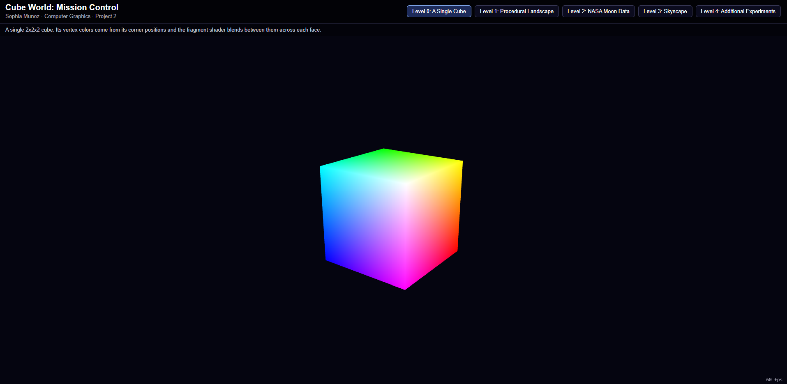
*Level 0: A Single Cube*

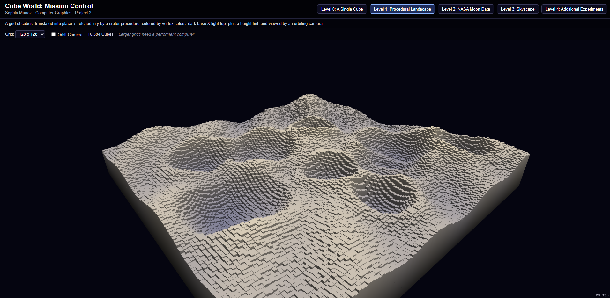
*Level 1: Procedural Crater Landscape*

**Level 2: NASA Moon Data**

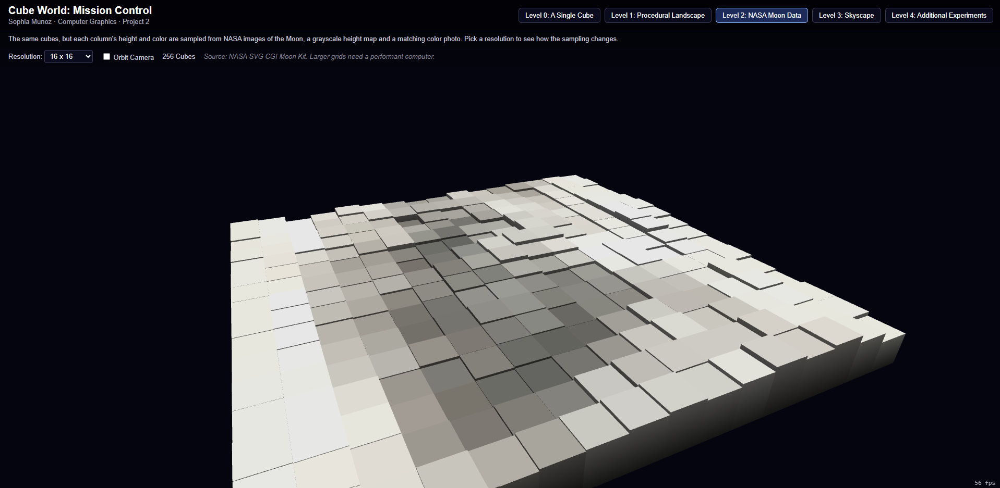
*Level 2: 16x16*

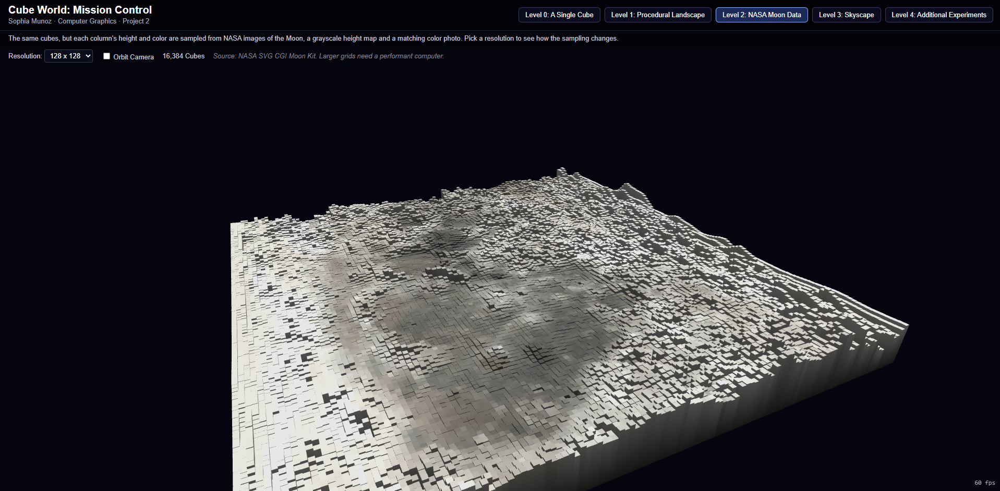
*Level 2: 128x128*

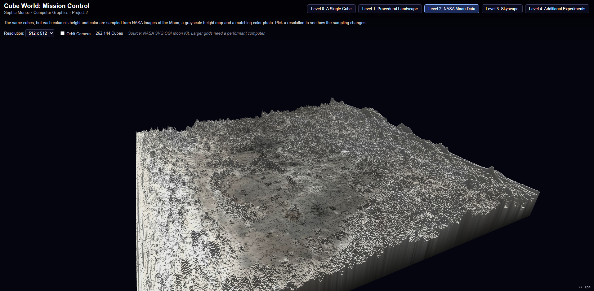
*Level 2: 512x512*

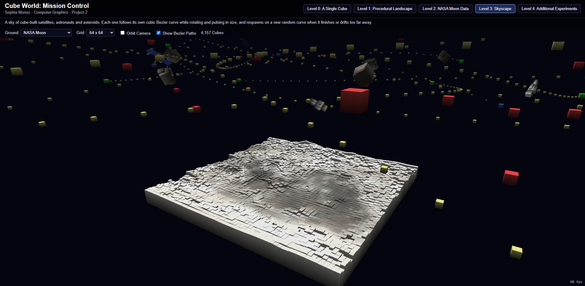
*Level 3: Bezier Paths with Control Points*

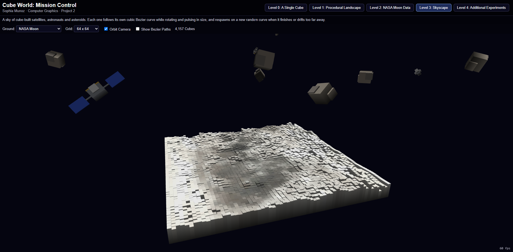
*Level 3: The Skyscape*

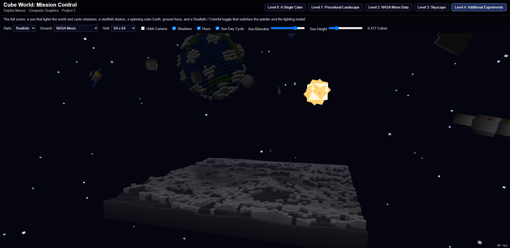
*Level 4: Realistic Style*

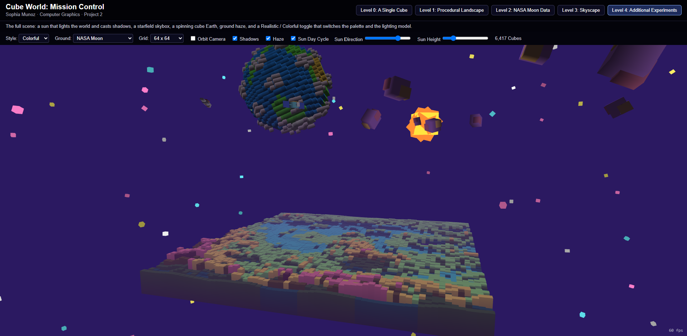
*Level 4: Colorful Style*

[Watch the Demo!]()